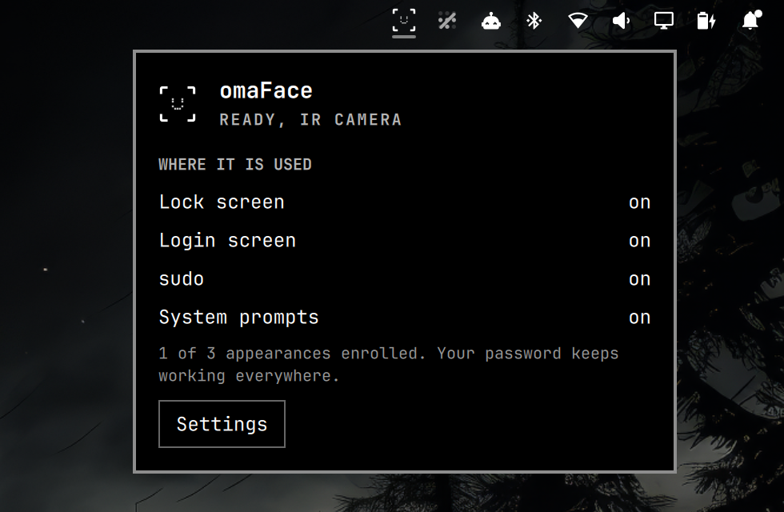

# omaFace for the bar

A bar widget for [omaFace](https://github.com/L0adn9/omaface), face unlock for
Omarchy 4: the lock screen, login, `sudo` and system prompts, with an IR
(Windows Hello) camera or the regular webcam. Your password keeps working
everywhere.

<p align="center">
  
</p>

* The omaFace mark sits in the bar and comes alive while a scan runs (the lock
  screen, `sudo`, a system prompt): it scans, turns into a check when it knows
  you, and shakes when it does not. Dimmed means omaFace is not ready yet.
* Click it for where face unlock is used, how many appearances are enrolled,
  and a way into omaFace's settings. Middle-click opens the settings directly.
* Without omaFace installed, the panel shows the commands to install it and a
  link to the guide. Installed but not set up, it offers to run
  `omaface setup` in a terminal, where it asks for your password once.

## Install

From the Omarchy plugin marketplace, or:

```
omarchy plugin add https://github.com/L0adn9/omaface-widget --enable
```

It lands on the right of the bar; move it with `omarchy bar move
io.github.l0adn9.omaface-bar --section <left|center|right>`.

Face unlock itself is omaFace, installed separately (it needs root for PAM
and its scanner, which a plugin should not do on its own):

```
git clone https://github.com/L0adn9/omaface ~/.local/src/omaface
cd ~/.local/src/omaface && ./install.sh
```

## Remove

```
omarchy plugin remove io.github.l0adn9.omaface-bar
```

This removes only the widget. omaFace stays until `omaface uninstall`.

## What it reads and runs

* `/run/omaface/status`, the scanner's live state, written by omaFace.
* `omaface status --json`, when the panel opens and after a scan.
* `omaface settings` and `omaface setup` (in a terminal), when you click them.
* `wl-copy` for **Copy commands**, and your browser for **Read the guide**.

No network access, no background process, nothing installed or changed on its
own.

## Dependencies

* Omarchy 4 or newer.
* [omaFace](https://github.com/L0adn9/omaface) for anything beyond the install
  instructions.
* `wl-clipboard` (`wl-copy`), part of Omarchy.

## License

MIT. Not affiliated with Omarchy or 37signals.
